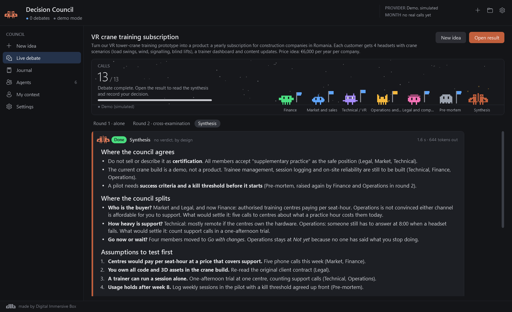

<p align="center">
  
</p>

<h1 align="center">Decision Council</h1>

<p align="center">
  A Windows app where a panel of AI agents with different mandates challenges your business or project idea,<br>
  cross-examines itself, and shows you where it agrees, where it splits and what to test first. <b>You</b> decide.
</p>

<p align="center">
  <a href="https://github.com/DigitalImmersiveBox/DecisionCouncil/releases/latest"><b>⬇ Download for Windows</b></a>
  &nbsp;·&nbsp;
  <a href="#features">Features</a>
  &nbsp;·&nbsp;
  <a href="#build-from-source">Build from source</a>
</p>

---

## Features

<p align="center">
  
</p>

- **A council, not a chatbot.** Each agent (Finance, Market and sales, Technical, Operations, Legal, Pre-mortem) first answers alone. In round 2 they read each other and cross-examine. A synthesis then shows where they agree, where they split and which assumptions to test first. It gives no verdict, by design.
- **Agents are files.** Every agent is a Markdown file with its mandate. Edit them in the app, switch them on or off, add your own, and test one on a sample idea.
- **Your context.** `context.md` tells every agent who you are, what you have and what you won't do, so the answers fit your situation.
- **A decision journal.** Record what you decided, set a revisit date, and later note what actually happened and which agents' warnings came true. Export any debate to Markdown.
- **Usage limit.** Real calls record tokens and cost. Set a monthly limit: the app warns at a set percentage and refuses to start calls once it is reached.
- **Demo mode.** Try the whole flow with simulated answers, without using any credit.

## Install

1. Download **`DecisionCouncil-<version>-win-x64.zip`** from the [latest release](https://github.com/DigitalImmersiveBox/DecisionCouncil/releases/latest).
2. Unzip it anywhere (for example `%LocalAppData%\Programs\DecisionCouncil`) and run **`DecisionCouncil.exe`**.
3. Windows SmartScreen may warn you because the app isn't code-signed. Click **More info → Run anyway**.

The app starts in **Demo mode**. Click **Load sample idea** on the New idea screen and press **Start debate** to see the whole flow.

To use real models, open **Settings → Model provider → Claude Code CLI**. Every agent call then runs `claude -p` with your own Claude Code login and plan. **Sign in** in the same section opens Claude Code's login if you aren't signed in yet. The app never stores credentials.

### Updating

Decision Council checks GitHub for a new release a minute after it starts and then twice a day. When it finds one, a banner appears at the top of the window. Click **Update now** there, or under **Settings → Updates**. It downloads the release, checks it against the release's SHA-256, puts the new exe in place of the old one and restarts. Your data and settings stay as they are.

### Requirements

- Windows 10 or 11, 64-bit.
- For real debates: [Claude Code](https://code.claude.com) installed and signed in on the same PC. Demo mode needs nothing else.

The release zip is self-contained, so you don't need to install .NET. The release also has a smaller `DecisionCouncil-<version>-win-x64-framework.zip` for people who already have the [.NET 10 Desktop Runtime](https://dotnet.microsoft.com/download/dotnet/10.0).

## Privacy

- **Your ideas and debates** stay on your PC, in a SQLite database in the data folder. In Claude Code CLI mode, each agent's prompt is sent to Claude through your own Claude Code login, as any Claude Code request would be.
- **Updates:** it asks `api.github.com` for this repository's latest release, and downloads it from GitHub only when you choose to update.
- **Data folder:** `%LocalAppData%\DecisionCouncil\Data` by default, holding `agents\`, `prompts\`, `context.md`, `council.db` and `exports\`. Back up by copying the folder. Settings live in `%LocalAppData%\DecisionCouncil\settings.json`.

## Build from source

You need the [.NET 10 SDK](https://dotnet.microsoft.com/download/dotnet/10.0) on Windows.

```bash
dotnet run --project src/DecisionCouncil.App
```

To build the release zips (a self-contained single-file exe, and a small one that needs the .NET runtime) with their notes and SHA-256 hashes:

```powershell
./release.ps1
```

Bump `<Version>` in `src/DecisionCouncil.App/DecisionCouncil.App.csproj` first. `./release.ps1 -WhatsNew whats-new.md -Publish` also creates the GitHub release with [gh](https://cli.github.com); the updater offers any release whose tag is newer than the running version.

### Project layout

```
src/
  DecisionCouncil.Core/      engine, no UI
    Providers/               IModelProvider, ClaudeCliProvider, DemoProvider (+ canned DemoScript)
    Agents/                  markdown agent files → AgentDefinition
    Debate/                  PromptBuilder, DebateEngine (round 1 → round 2 → synthesis)
    Storage/                 CouncilStore (SQLite: ideas, debates, agent_runs, decisions)
    Usage/                   monthly limit check before every real call
    Export/                  Markdown export
    Council.cs               wires it all together
  DecisionCouncil.App/       WPF screens (MVVM), updater
  DecisionCouncil.Cli/       command-line runner for the engine
defaults/                    agents, shared prompts and context template, embedded in the app and seeded into the data folder on first run
design/icon/                 app icon source and concepts
```

### How it works

- **Isolation.** Every agent call is a separate `claude -p` process in an empty temp folder, run with `--tools ""`, `--disallowedTools "mcp__*"`, `--strict-mcp-config` and `--no-session-persistence`. The prompt goes in on stdin and the agent file goes in through `--system-prompt-file`. Agents see nothing from each other until round 2.
- **Everything is saved as it arrives.** Each finished call is written to SQLite at once, so Cancel, a crash or exhausted credit keeps the debate so far.
- **Agents are files.** Drop a `.md` into the agents folder (or press **New agent**) and it appears on the New idea screen. Files starting with `_` are ignored. The shared rules, the round-2 instructions and the synthesizer prompt are files too (`prompts/`).

### Command-line flags

| Flag | Does |
| --- | --- |
| `--data <folder>` | Uses another data folder without touching your saved settings. |
| `--tour <folder>` | Clicks through every screen in demo mode, saves a PNG of each and closes. Use it with `--data`. |

```bash
dotnet run --project src/DecisionCouncil.App -- --data %TEMP%\dc-tour --tour %TEMP%\dc-shots
```

### Command-line runner

```bash
dotnet run --project src/DecisionCouncil.Cli -- run --provider demo --idea "Sell VR crane training as a subscription"
```

Commands: `run`, `agents`, `list`, `show <id>`, `check`. Add `--data <folder>` to use a throwaway data folder and `--speed 5` for faster demo answers. `check` only runs `claude --version` and never calls a model.

### Look and feel

The app uses the shared dib dark UI from [Session Deck](https://github.com/DigitalImmersiveBox/SessionDeck), kept in one resource dictionary, [`Theme/DibDark.xaml`](src/DecisionCouncil.App/Theme/DibDark.xaml). The rules for using it are in [docs/UI-GUIDELINES.md](docs/UI-GUIDELINES.md). Each council member is a small animated pixel creature in its agent's colour; all motion stops when Windows' "Show animations" setting is off.

## Notes

- Each user needs their own Claude Code install and login. The app runs the CLI as you, on your plan.
- Anthropic's terms for programmatic use of a subscription change over time. Check "Use the Claude Agent SDK with your Claude plan" in the Claude Help Center before relying on it.
- Paths longer than 260 characters break SQLite on Windows, so keep the data folder path short.

## License

[MIT](LICENSE) © Digital Immersive Box
